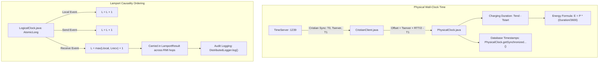
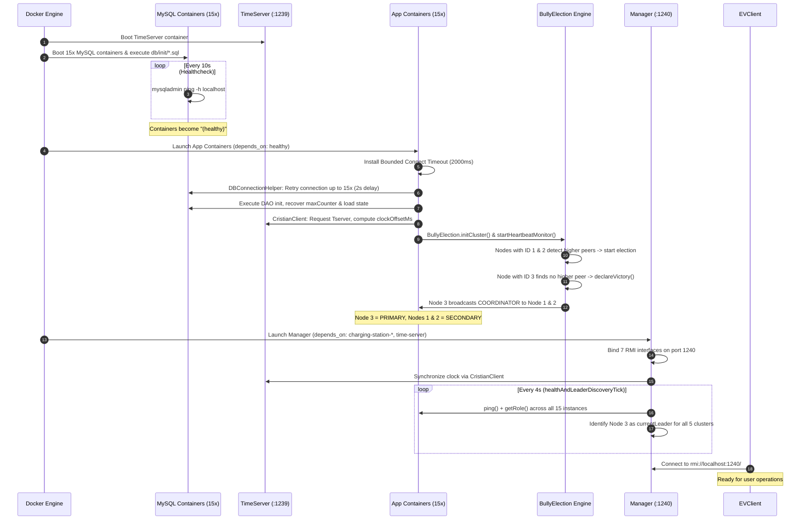

# Distributed EV Charging Network — Comprehensive Architecture & Systems Manual

> **Document Target:** Complete architectural breakdown, boot-up orchestration lifecycle, and exhaustive edge case analysis for the Distributed EV Charging Network Management System.

---

## Table of Contents

1. [Executive Summary & Core Engineering Philosophy](#1-executive-summary--core-engineering-philosophy)
2. [End-to-End System Architecture](#2-end-to-end-system-architecture)
   - [2.1 High-Level Component Topology](#21-high-level-component-topology)
   - [2.2 The 32-Container Containerization Map](#22-the-32-container-containerization-map)
   - [2.3 Shared-Nothing Database Architecture](#23-shared-nothing-database-architecture)
   - [2.4 Dual Clock Abstraction: Cristian vs. Lamport](#24-dual-clock-abstraction-cristian-vs-lamport)
3. [Cluster Services & Module Breakdown](#3-cluster-services--module-breakdown)
   - [3.1 ChargingStation Cluster (Ports P1–P4)](#31-chargingstation-cluster-ports-p1p4)
   - [3.2 Reservation Cluster (Slot Leasing & Concurrency)](#32-reservation-cluster-slot-leasing--concurrency)
   - [3.3 ChargingSession Cluster (Real-Time Physics & State)](#33-chargingsession-cluster-real-time-physics--state)
   - [3.4 Pricing Cluster (Dynamic Tariffs & Demand Multipliers)](#34-pricing-cluster-dynamic-tariffs--demand-multipliers)
   - [3.5 Payment Cluster (Settlements & Wallet Accounting)](#35-payment-cluster-settlements--wallet-accounting)
   - [3.6 TimeServer (The Physical Reference Clock)](#36-timeserver-the-physical-reference-clock)
   - [3.7 ReservationServerManager (Single Entry Point, Proxy & Router)](#37-reservationservermanager-single-entry-point-proxy--router)
4. [Chronological Boot-Up Sequence (What Happens on Startup)](#4-chronological-boot-up-sequence-what-happens-on-startup)
   - [Phase A: Docker Compose & Healthcheck Dependency Gates](#phase-a-docker-compose--healthcheck-dependency-gates)
   - [Phase B: Network Setup & Bounded Socket Factories](#phase-b-network-setup--bounded-socket-factories)
   - [Phase C: Database Connection, Self-Seeding & Monotonic Counter Recovery](#phase-c-database-connection-self-seeding--monotonic-counter-recovery)
   - [Phase D: Cristian Physical Clock Synchronization](#phase-d-cristian-physical-clock-synchronization)
   - [Phase E: Cluster Membership Initialization & Initial Bully Election](#phase-e-cluster-membership-initialization--initial-bully-election)
   - [Phase F: Manager Initialization & Background Discovery Polling](#phase-f-manager-initialization--background-discovery-polling)
   - [Phase G: Client Bootstrap & Interactive Execution](#phase-g-client-bootstrap--interactive-execution)
5. [In-Depth Edge Cases & Resilience Mechanisms](#5-in-depth-edge-cases--resilience-mechanisms)
   - [Edge Case 1: Leader Crash Mid-Operation (Failover During Active Write)](#edge-case-1-leader-crash-mid-operation-failover-during-active-write)
   - [Edge Case 2: Node Rejoin & Bully Usurpation (Leader Failback)](#edge-case-2-node-rejoin--bully-usurpation-leader-failback)
   - [Edge Case 3: Cold-Boot Network Asynchrony & Lost Election Packets](#edge-case-3-cold-boot-network-asynchrony--lost-election-packets)
   - [Edge Case 4: Zombie / Stopped Container TCP Hangs (2-Second Connect Timeout)](#edge-case-4-zombie--stopped-container-tcp-hangs-2-second-connect-timeout)
   - [Edge Case 5: Self-Deadlock on Synchronized Replication Fan-Out](#edge-case-5-self-deadlock-on-synchronized-replication-fan-out)
   - [Edge Case 6: Primary Key Collisions on Replicated Inserts](#edge-case-6-primary-key-collisions-on-replicated-inserts)
   - [Edge Case 7: Database Unreachability & Graceful In-Memory Degradation](#edge-case-7-database-unreachability--graceful-in-memory-degradation)
   - [Edge Case 8: ID Collision Prevention via Database Counter Recovery](#edge-case-8-id-collision-prevention-via-database-counter-recovery)
   - [Edge Case 9: Physical Clock Skew vs. Real-Time Energy Computation](#edge-case-9-physical-clock-skew-vs-real-time-energy-computation)
   - [Edge Case 10: Background Cross-Server Wallet Billing & Mid-Cycle Failover](#edge-case-10-background-cross-server-wallet-billing--mid-cycle-failover)
   - [Edge Case 11: Network Partition & Split-Brain Potential in Bully Election](#edge-case-11-network-partition--split-brain-potential-in-bully-election)
   - [Edge Case 12: Read Stale-State Prevention Across Round-Robin Replicas](#edge-case-12-read-stale-state-prevention-across-round-robin-replicas)
   - [Edge Case 13: High-Concurrency Thread Contention & Port Over-Allocation](#edge-case-13-high-concurrency-thread-contention--port-over-allocation)
6. [Summary Verification Matrix](#6-summary-verification-matrix)

---

## 1. Executive Summary & Core Engineering Philosophy

The **Distributed EV Charging Network Management System** is a fault-tolerant, highly available, distributed microservice cluster engineered using **Java RMI (Remote Method Invocation)**, deployed across **32 Docker containers**.

The system simulates a smart electric vehicle charging infrastructure where clients can reserve physical charging bays, start and monitor charging sessions, compute real-time energy draw based on physical time, calculate dynamic demand-weighted pricing tariffs, and settle payments either post-session or automatically via a real-time debiting wallet.

### Foundational Distributed Computing Pillars:
1. **Bully Leader Election**: Every service runs as an independent 3-node cluster ($N=3$). Each cluster independently executes the Bully algorithm to elect its own coordinator based on `SERVER_ID`. There is no single global leader; failure in one cluster does not affect leadership in another.
2. **Primary-Backup Replication**: State-mutating writes are handled exclusively by the cluster PRIMARY (leader) and immediately fanned out to SECONDARY peer replicas via the Manager before returning a success acknowledgment.
3. **Smart Routing & Load Balancing**: The `ReservationServerManager` serves as an intelligent reverse proxy. Read-only requests are round-robin load-balanced across healthy replicas, while write requests are strictly routed to the current PRIMARY.
4. **Dual Clock Architecture**:
   - **Cristian's Algorithm**: Synchronizes wall-clock time against a dedicated `TimeServer` to counter clock drift deliberately injected by `libfaketime`. Physical time is used **exclusively** for physical duration, energy formulas ($E = P \times T$), tariffs, and database timestamps.
   - **Lamport Logical Clocks**: Maintains a scalar monotonic counter (`AtomicLong`) incremented via standard causal rules ($L+1$ on send/local, $\max(L_{\text{local}}, L_{\text{recv}}) + 1$ on receive). Used **exclusively** for event ordering across decoupled JVMs.
5. **Shared-Nothing Persistence**: Every application instance has its own private MySQL 8.0 database container (15 database instances total). Cross-database foreign keys are strictly prohibited; entity references are resolved solely over RMI.

---

## 2. End-to-End System Architecture

### 2.1 High-Level Component Topology

```
+----------------------------------------------------------------------------------------------------+
|                                         CLIENT TIER                                                |
|                                                                                                    |
|    [ EVClient.java (Console) ]     [ MultithreadTest.java ]     [ WalletDemo.java ]                |
+--------------------------------------------------+-------------------------------------------------+
                                                   | RMI (Single Entry Point :1240)
                                                   v
+----------------------------------------------------------------------------------------------------+
|                                    MANAGEMENT & ROUTING TIER                                       |
|                                                                                                    |
|                               ReservationServerManager (:1240/2240)                                |
|   - Dynamic Leader Discovery Tick (every 4s)          - Read Load Balancer (Round-Robin)           |
|   - Write Router (Leader-Only Routing)                - Replication Fan-Out Dispatcher             |
+-----+-----------------------+------------------------+-----------------------+---------------------+
      |                       |                        |                       |
      v                       v                        v                       v
+---------------+       +---------------+        +---------------+       +---------------+
|ChargingStation|       |  Reservation  |        |ChargingSession|       |    Payment    |
| Cluster (x3)  |       |  Cluster (x3) |        | Cluster (x3)  |       |  Cluster (x3) |
|  CS1, CS2, CS3|       |   R1, R2, R3  |        |   S1, S2, S3  |       |Pay1,Pay2,Pay3 |
+-------+-------+       +-------+-------+        +-------+-------+       +-------+-------+
        |                       |                        |                       |
        +-----------------------+-----------+------------+-----------------------+
                                            v
                                   +-----------------+
                                   |     Pricing     |
                                   |  Cluster (x3)   |
                                   |   P1, P2, P3    |
                                   +--------+--------+
                                            |
                                            v
                                   +-----------------+
                                   |   TimeServer    |
                                   |   (:1239/2239)  |
                                   +-----------------+
```

### 2.2 The 32-Container Containerization Map

The system is configured in [`docker-compose.yml`](file:///c:/Users/asus/Desktop/College/Sem%205/DC/Java/docker-compose.yml) comprising 32 active containers:

| Category | Count | Service / Container Names | Host / Registry Ports | Export Ports | Associated Database |
|---|---|---|---|---|---|
| **Infrastructure** | 1 | `time-server` | `1239` | `2239` | None (Stateless) |
| **Manager** | 1 | `manager` | `1240` | `2240` | None (Proxy/Router) |
| **Charging Station** | 3 | `charging-station-1`<br>`charging-station-2`<br>`charging-station-3` | `1234`<br>`1244`<br>`1254` | `2234`<br>`2244`<br>`2254` | `ev_station_db`<br>`ev_station_db_2`<br>`ev_station_db_3` |
| **Station DBs** | 3 | `mysql-station-1`<br>`mysql-station-2`<br>`mysql-station-3` | `3306` (Internal) | — | Dedicated MySQL 8.0 volumes |
| **Reservation** | 3 | `reservation-1`<br>`reservation-2`<br>`reservation-3` | `1245`<br>`1255`<br>`1235` | `2245`<br>`2255`<br>`2235` | `ev_reservation_secondary_db`<br>`ev_reservation_tertiary_db`<br>`ev_reservation_primary_db` |
| **Reservation DBs**| 3 | `mysql-reservation-1`<br>`mysql-reservation-2`<br>`mysql-reservation-3` | `3308`<br>`3309`<br>`3307` | — | Dedicated MySQL 8.0 volumes |
| **Charging Session**| 3 | `charging-session-1`<br>`charging-session-2`<br>`charging-session-3` | `1236`<br>`1246`<br>`1256` | `2236`<br>`2246`<br>`2256` | `ev_session_db`<br>`ev_session_db_2`<br>`ev_session_db_3` |
| **Session DBs** | 3 | `mysql-session-1`<br>`mysql-session-2`<br>`mysql-session-3` | `3306` (Internal) | — | Dedicated MySQL 8.0 volumes |
| **Pricing** | 3 | `pricing-1`<br>`pricing-2`<br>`pricing-3` | `1238`<br>`1248`<br>`1258` | `2238`<br>`2248`<br>`2258` | `ev_pricing_db`<br>`ev_pricing_db_2`<br>`ev_pricing_db_3` |
| **Pricing DBs** | 3 | `mysql-pricing-1`<br>`mysql-pricing-2`<br>`mysql-pricing-3` | `3306` (Internal) | — | Dedicated MySQL 8.0 volumes |
| **Payment** | 3 | `payment-1`<br>`payment-2`<br>`payment-3` | `1237`<br>`1247`<br>`1257` | `2237`<br>`2247`<br>`2257` | `ev_payment_db`<br>`ev_payment_db_2`<br>`ev_payment_db_3` |
| **Payment DBs** | 3 | `mysql-payment-1`<br>`mysql-payment-2`<br>`mysql-payment-3` | `3306` (Internal) | — | Dedicated MySQL 8.0 volumes |
| **Total** | **32** | — | — | — | **15 Independent Databases** |

### 2.3 Shared-Nothing Database Architecture

The persistence model enforces strict database decoupling. Each cluster node has its own database container. The schema details are defined in [`docs/DATABASE_SCHEMA.md`](file:///c:/Users/asus/Desktop/College/Sem%205/DC/Java/docs/DATABASE_SCHEMA.md):
- **`charging_ports`**: Stores `port_id`, `station_id`, `status` (`AVAILABLE`, `RESERVED`, `CHARGING`), and `last_updated`.
- **`reservations`**: Stores `reservation_id`, `user_id`, `vehicle_id`, `port_id`, `status` (`CONFIRMED`, `CANCELLED`), and `created_at`.
- **`charging_sessions`**: Stores `session_id`, `reservation_id`, `port_id`, `status` (`CHARGING`, `COMPLETED`), `start_time`, `end_time`, `charging_power_kw` (7.2 kW default), and `energy_consumed_kwh`.
- **`station_pricing_tariffs`**: Stores `station_id`, `base_price_per_kwh` (Rs. 10.0 default), `demand_level` (`LOW`, `MEDIUM`, `HIGH`), and `demand_multiplier` (1.0, 1.2, 1.5).
- **`payments` & `wallets`**: Stores `payment_id`, `session_id`, `station_id`, `energy_consumed_kwh`, `total_amount`, `payment_status`, and user wallet balances in `wallets` (`user_id`, `balance`, `last_updated`).

> [!IMPORTANT]
> **No Foreign Keys Cross Service Boundaries**: Cross-table relations (`reservation_id` $\rightarrow$ `session_id` $\rightarrow$ `payment_id`) are purely logical and resolved strictly via RMI RPCs.

### 2.4 Dual Clock Abstraction: Cristian vs. Lamport

The architecture isolates physical time from logical time:



1. **Physical Clock (`PhysicalClock.java`)**: 
   $$\Delta_{\text{offset}} = T_{\text{server}} + \frac{T_1 - T_0}{2} - T_1$$
   Used **strictly** for calculating time differences ($T_{\text{end}} - T_{\text{start}}$), physical energy consumption in kWh ($E = P \times T$), price tariffs, and database audit columns.
2. **Lamport Logical Clock (`LogicalClock.java`)**:
   Implemented with lock-free `AtomicLong` CAS operations:
   $$L_{\text{updated}} = \max(L_{\text{local}}, L_{\text{received}}) + 1$$
   Used **strictly** to establish an unambiguous partial ordering of distributed events across the independent JVMs.

---

## 3. Cluster Services & Module Breakdown

### 3.1 ChargingStation Cluster (Ports P1–P4)
- **Files**: [`ChargingStationServer.java`](file:///c:/Users/asus/Desktop/College/Sem%205/DC/Java/ChargingStation/ChargingStationServer.java), [`ChargingStationInterface.java`](file:///c:/Users/asus/Desktop/College/Sem%205/DC/Java/ChargingStation/ChargingStationInterface.java), [`ChargingStationDAO.java`](file:///c:/Users/asus/Desktop/College/Sem%205/DC/Java/ChargingStation/ChargingStationDAO.java).
- **Instances**: `charging-station-1` (ID=1, :1234), `charging-station-2` (ID=2, :1244), `charging-station-3` (ID=3, :1254).
- **Core State**: In-memory arrays `ports[] = {"P1","P2","P3","P4"}` and `portStatus[]`.
- **State Machine**: `AVAILABLE` $\xrightarrow{\text{reservePort}}$ `RESERVED` $\xrightarrow{\text{startPortCharging}}$ `CHARGING` $\xrightarrow{\text{releasePort}}$ `AVAILABLE`.
- **Replication**: State changes invoke `ClusterManagerClient.replicate("ChargingStationService", serverId, delta, clock)`.

### 3.2 Reservation Cluster (Slot Leasing & Concurrency)
- **Files**: [`ReservationServer.java`](file:///c:/Users/asus/Desktop/College/Sem%205/DC/Java/Reservation/ReservationServer.java), [`ReservationInterface.java`](file:///c:/Users/asus/Desktop/College/Sem%205/DC/Java/Reservation/ReservationInterface.java), [`ReservationDAO.java`](file:///c:/Users/asus/Desktop/College/Sem%205/DC/Java/Reservation/ReservationDAO.java).
- **Instances**: `reservation-1` (ID=1, :1245), `reservation-2` (ID=2, :1255), `reservation-3` (ID=3, :1235).
- **Core State**: Maps `reservations` (`resId` $\rightarrow$ details) and `reservationPorts` (`resId` $\rightarrow$ `portId`), counter `reservationCounter` (starts at 1001).
- **Workflow**: On `reserveSlot(userId, vehicleId)`, PRIMARY calls `ChargingStation.reserveAnyAvailablePort()` via Manager, saves locally, persists to MySQL, and calls Manager replication.

### 3.3 ChargingSession Cluster (Real-Time Physics & State)
- **Files**: [`ChargingSessionServer.java`](file:///c:/Users/asus/Desktop/College/Sem%205/DC/Java/ChargingSession/ChargingSessionServer.java), [`ChargingSessionInterface.java`](file:///c:/Users/asus/Desktop/College/Sem%205/DC/Java/ChargingSession/ChargingSessionInterface.java), [`ChargingSessionDAO.java`](file:///c:/Users/asus/Desktop/College/Sem%205/DC/Java/ChargingSession/ChargingSessionDAO.java).
- **Instances**: `charging-session-1` (ID=1, :1236), `charging-session-2` (ID=2, :1246), `charging-session-3` (ID=3, :1256).
- **Core State**: Maps for `sessionStatus`, `energyConsumed`, `sessionStartTimes`, `sessionEndTimes`, `sessionChargingPowers` (7.2 kW default).
- **Formulas**:
  $$\text{Duration (seconds)} = \frac{T_{\text{end}} - T_{\text{start}}}{1000.0}$$
  $$\text{Energy (kWh)} = 7.20\text{ kW} \times \frac{\text{Duration (seconds)}}{3600.0}$$
- **Automated Billing Loop**: Features a background thread pool executing every 5 seconds, evaluating active sessions and invoking `PaymentServer.checkAndDeductBalance()` over RMI.

### 3.4 Pricing Cluster (Dynamic Tariffs & Demand Multipliers)
- **Files**: [`PricingServer.java`](file:///c:/Users/asus/Desktop/College/Sem%205/DC/Java/Pricing/PricingServer.java), [`PricingInterface.java`](file:///c:/Users/asus/Desktop/College/Sem%205/DC/Java/Pricing/PricingInterface.java), [`PricingDAO.java`](file:///c:/Users/asus/Desktop/College/Sem%205/DC/Java/Pricing/PricingDAO.java).
- **Instances**: `pricing-1` (ID=1, :1238), `pricing-2` (ID=2, :1248), `pricing-3` (ID=3, :1258).
- **Characteristics**: Pure read-replicas. Tariffs are loaded at boot (`S01`=LOW/1.0x, `S02`=MEDIUM/1.2x, `S03`=HIGH/1.5x, base rate = Rs. 10.00/kWh). Since tariffs are immutable at runtime, no write-replication is needed.

### 3.5 Payment Cluster (Settlements & Wallet Accounting)
- **Files**: [`PaymentServer.java`](file:///c:/Users/asus/Desktop/College/Sem%205/DC/Java/Payment/PaymentServer.java), [`PaymentInterface.java`](file:///c:/Users/asus/Desktop/College/Sem%205/DC/Java/Payment/PaymentInterface.java), [`PaymentDAO.java`](file:///c:/Users/asus/Desktop/College/Sem%205/DC/Java/Payment/PaymentDAO.java).
- **Instances**: `payment-1` (ID=1, :1237), `payment-2` (ID=2, :1247), `payment-3` (ID=3, :1257).
- **Responsibilities**:
  - `makePayment(sessionId)`: Verifies `COMPLETED` session status, reads energy, calls `Pricing.calculatePrice`, writes payment `PAY-100x`, releases port to `AVAILABLE`, and replicates.
  - `addFunds(userId, amount)` & `checkAndDeductBalance(...)`: In-memory wallet balance tracking persisted to `wallets` table and replicated across cluster nodes.

### 3.6 TimeServer (The Physical Reference Clock)
- **Files**: [`TimeServer.java`](file:///c:/Users/asus/Desktop/College/Sem%205/DC/Java/Clock/TimeServer.java), [`TimeServerInterface.java`](file:///c:/Users/asus/Desktop/College/Sem%205/DC/Java/Clock/TimeServerInterface.java).
- **Role**: Exports `getPhysicalTimeMillis()`. Authoritative reference physical clock for the network, running without artificial skew.

### 3.7 ReservationServerManager (Single Entry Point, Proxy & Router)
- **File**: [`ReservationServerManager.java`](file:///c:/Users/asus/Desktop/College/Sem%205/DC/Java/Reservation/ReservationServerManager.java).
- **Port**: Registry on `1240`, Export on `2240`.
- **Bound Interfaces**: Exposes `ReservationManager`, `ReservationService`, `ChargingStationService`, `ChargingSessionService`, `PricingService`, `PaymentService`, and `ClusterManager`.
- **Routing Engine**:
  - `pickForRead(cluster)`: Atomic round-robin index across healthy replicas (`ClusterConfig.healthy`).
  - `pickForWrite(cluster)`: Routes strictly to `ClusterConfig.currentLeader`. If leader call fails, forces an immediate discovery pass (`healthAndLeaderDiscoveryTick()`) and retries once.
  - `replicateUpdate(...)`: Fans out `StateDelta` to all peers in the cluster, **excluding the origin node**.

---

## 4. Chronological Boot-Up Sequence (What Happens on Startup)

The boot-up sequence follows strict dependency ordering and convergence:



### Detailed Boot-Up Stages:

#### Phase A: Docker Compose & Healthcheck Dependency Gates
1. When `docker compose up -d --build` is executed, Docker evaluates the dependency graph in [`docker-compose.yml`](file:///c:/Users/asus/Desktop/College/Sem%205/DC/Java/docker-compose.yml).
2. `time-server` starts immediately (stateless Java JVM, binding port 1239).
3. The 15 MySQL containers start in parallel. Each container mounts its corresponding SQL file from `db/init/` into `/docker-entrypoint-initdb.d/init.sql`. The database initializes schemas, tables, and indexes without inserting any fake data.
4. Docker's healthcheck executes `mysqladmin ping -h localhost -uroot -pevroot` every 10 seconds.
5. Application containers declare `depends_on: { <db>: { condition: service_healthy }, time-server: { condition: service_started } }`. The JVM processes will **not** start until MySQL returns exit code 0 on ping.

#### Phase B: Network Setup & Bounded Socket Factories
1. The `main()` method of each server class executes.
2. The server calls [`NetworkSetup.installBoundedConnectTimeout()`](file:///c:/Users/asus/Desktop/College/Sem%205/DC/Java/Common/NetworkSetup.java). This overrides the default Java `RMISocketFactory` with a custom implementation enforcing a strict **2000 ms socket connect timeout** (`socket.connect(..., 2000)`).
3. `ServerIdentity.fromEnvironment(...)` reads container environment variables (`SERVER_ID`, `PEERS`, `RMI_REGISTRY_PORT`, `RMI_EXPORT_PORT`, `MANAGER_HOST`, `DB_HOST`).
4. The local RMI registry is created on `RMI_REGISTRY_PORT` using `LocateRegistry.createRegistry(...)`.

#### Phase C: Database Connection, Self-Seeding & Monotonic Counter Recovery
1. The server executes `initWithDatabase()`.
2. [`DBConnectionHelper.getConnectionWithRetry(serverName, 15)`](file:///c:/Users/asus/Desktop/College/Sem%205/DC/Java/DBConnectionHelper.java) attempts connection with 2-second intervals, handling any lingering MySQL startup delays.
3. If connected, the DAO executes recovery:
   - **`ChargingStationDAO`**: Calls `initPortsIfEmpty(...)`. If the `charging_ports` table is empty, it self-seeds `P1` through `P4` with status `AVAILABLE` using Cristian-corrected time. Then it calls `loadAllPorts()` into `portStatus[]`.
   - **`ReservationDAO`**: Calls `loadAllReservations()`. Executes query:
     ```sql
     SELECT COALESCE(MAX(CAST(SUBSTRING(reservation_id, 4) AS UNSIGNED)), 1000) FROM reservations;
     ```
     Sets `reservationCounter = maxCounter + 1` (e.g. `1001`), ensuring ID continuity across restarts.
   - **`ChargingSessionDAO`**: Calls `loadAllSessions()` and recovers `sessionCounter` from `SUBSTRING(session_id, 9)`.
   - **`PricingDAO`**: Calls `initTariffsIfEmpty(...)`. Self-seeds stations `S01` (LOW), `S02` (MEDIUM), `S03` (HIGH) if table is empty.
   - **`PaymentDAO`**: Calls `loadAllPayments()`, `loadAllWallets()`, and recovers `paymentCounter` from `SUBSTRING(payment_id, 5)`.

#### Phase D: Cristian Physical Clock Synchronization
1. Each application server calls `synchronizeClock()`.
2. [`CristianClient.synchronize(...)`](file:///c:/Users/asus/Desktop/College/Sem%205/DC/Java/Clock/CristianClient.java) contacts `rmi://time-server:1239/TimeServer`.
3. Records local time $T_0$, reads remote time $T_{\text{server}}$, records local time $T_1$.
4. Computes $RTT = T_1 - T_0$, calculates offset, and sets `PhysicalClock.setClockOffsetMs(offset)`.
5. Prints the synchronization report with local time before sync, server time, RTT, and calculated offset.

#### Phase E: Cluster Membership Initialization & Initial Bully Election
1. Each node calls `initCluster(selfHost)`:
   - Evaluates the peer list (`identity.peers`).
   - Identifies the maximum ID among itself and peers.
   - Sets its tentative role: `PRIMARY` if it has the highest ID, otherwise `SECONDARY`.
2. Instantiates [`BullyElection`](file:///c:/Users/asus/Desktop/College/Sem%205/DC/Java/Common/BullyElection.java) and calls `startHeartbeatMonitor()`.
3. Heartbeat loop runs every 3000 ms (`heartbeatTick`).
4. On cold boot:
   - Nodes 1 and 2 ping coordinator (tentatively ID 3) or start an election because no coordinator announcement has been verified yet.
   - Nodes 1 and 2 send `ELECTION` to higher peers.
   - Node 3 receives `ELECTION`, replies `OK`, and starts its own election.
   - Node 3 has no higher peers in `PEERS`. It declares victory (`declareVictory()`), sets its role to `PRIMARY`, and calls `broadcastCoordinator()`.
   - Node 3 delivers `COORDINATOR` announcements to Nodes 1 and 2 using `lookupPeerWithRetry(peer, 6, 1000)`.
   - Nodes 1 and 2 receive `COORDINATOR`, set their role to `SECONDARY`, and store Node 3 as their active coordinator.
5. The server binds its unique RMI name to its registry: `rmi://localhost:<port>/<Service>-<ID>` (e.g. `ChargingStationService-3`).

#### Phase F: Manager Initialization & Background Discovery Polling
1. `ReservationServerManager` boots on port `1240` (export port `2240`).
2. Registers custom socket factory (`NetworkSetup.installBoundedConnectTimeout()`).
3. Binds the 7 RMI service interfaces on port 1240.
4. Executes `synchronizeClock()` against `TimeServer`.
5. Starts the scheduled executor `healthAndLeaderDiscoveryTick()` every 4 seconds (initial delay 5 seconds).
6. On every tick, the Manager iterates through all 5 clusters and calls:
   - `node.ping(sendL)` $\rightarrow$ marks node healthy in `cfg.healthy`.
   - `node.getRole(rL)` $\rightarrow$ if role is `"PRIMARY"`, records node as `cfg.currentLeader`.
7. Once discovered, the Manager logs:
   ```
   [MANAGER] New leader for ChargingStation cluster = ChargingStationService-3
   [MANAGER] New leader for Reservation cluster = Reservation-3
   [MANAGER] New leader for ChargingSession cluster = ChargingSessionService-3
   [MANAGER] New leader for Pricing cluster = PricingService-3
   [MANAGER] New leader for Payment cluster = PaymentService-3
   ```

#### Phase G: Client Bootstrap & Interactive Execution
1. The user executes [`EVClient`](file:///c:/Users/asus/Desktop/College/Sem%205/DC/Java/EVClient.java) from the host machine.
2. EVClient sets socket factory redirecting Docker container hostnames to `localhost` if necessary.
3. Client prompts for User ID and Vehicle ID.
4. Client connects solely to Manager on `rmi://localhost:1240/`. The system is now fully settled and ready for transactions.

---

## 5. In-Depth Edge Cases & Resilience Mechanisms

### Edge Case 1: Leader Crash Mid-Operation (Failover During Active Write)

```
        Client                   Manager                  Node 2 (Secondary)        Node 3 (Primary - FAILING)
          |                         |                              |                             |
          |--- reserveSlot() ------>|                              |                             |
          |                         |--- reserveSlot() ----------->|                             X [CRASH / KILLED]
          |                         |    (Throws RemoteException)  |                             :
          |                         |                              |                             :
          |                         | [Manager Catches Exception]  |                             :
          |                         | [Forces Immediate Discovery] |                             :
          |                         |                              | <--- Missed Heartbeat ------:
          |                         |                              | <--- Missed Heartbeat (2x)--:
          |                         |                              | [Bully: Start Election]     :
          |                         |                              | [No higher peer responds]   :
          |                         |                              | [Node 2 Declares Victory]   :
          |                         |                              | [Role becomes PRIMARY]      :
          |                         |                              |                             :
          |                         |--- Discovery: getRole() ---->|                             :
          |                         |    Returns "PRIMARY"         |                             :
          |                         | [Leader updated to Node 2]   |                             :
          |                         |                              |                             :
          |                         |--- Retry Write to Node 2 --->|                             :
          |                         |                              | [Allocates Port P1]         :
          |                         |                              | [Inserts DB & Fans Out]     :
          |                         |<-- Success (RES1002) --------|                             :
          |<-- CONFIRMED -----------|                              |                             :
```

#### What Happens:
When a PRIMARY container fails (e.g., `docker stop reservation-3` or unexpected process termination) while a client request is executing:
1. **At Cluster Level**:
   - Surviving nodes (`reservation-1`, `reservation-2`) run their periodic `heartbeatTick()` every 3 seconds.
   - After 2 missed heartbeats (6 seconds), node 1 and node 2 presume node 3 is dead and call `startElection()`.
   - Node 1 sends `ELECTION` to node 2. Node 2 replies `OK` and begins its own election.
   - Node 2 attempts to send `ELECTION` to node 3. Because node 3 is dead, the call times out.
   - After `OK_WAIT_MS` (2000 ms), node 2 receives no higher-ranked response and executes `declareVictory()`.
   - Node 2 flips its internal role to `PRIMARY`, broadcasts `COORDINATOR` to node 1, and takes over write responsibilities.
2. **At Manager Level**:
   - The Manager's `proxyWrite` method encounters a `RemoteException` when attempting to route to the dead leader.
   - As implemented in [`ReservationServerManager.java:L1114-L1126`](file:///c:/Users/asus/Desktop/College/Sem%205/DC/Java/Reservation/ReservationServerManager.java#L1114-L1126):
     ```java
     log("LOCAL", "Write to leader failed: " + e.getMessage() + ". Forcing re-discovery and retrying once.");
     healthAndLeaderDiscoveryTick(); // Forces immediate health scan
     PeerHandle retryTarget = clusters.get(cluster).currentLeader;
     if (retryTarget != null && !retryTarget.equals(target)) {
         S stub2 = (S) lookupTyped(cluster, retryTarget);
         return call.call(stub2); // Transparent retry against new leader
     }
     ```
   - If the election has already settled, the client write succeeds on the retry without throwing an error to the caller.
   - If the election is still in flight, the call returns a fallback error; the client retries on the next keystroke, and the request succeeds against node 2.

#### Data Integrity Guarantee:
Node 2 already holds all confirmed reservations prior to node 3's death because writes are synchronously replicated before returning to clients. Node 2 continues issuing IDs from its recovered `reservationCounter` (`RES1002`, `RES1003`) without data loss or counter collisions.

---

### Edge Case 2: Node Rejoin & Bully Usurpation (Leader Failback)

#### What Happens:
When the former leader restarts (`docker start reservation-3`):
1. Node 3 boots up with no memory of whether another node became leader during its downtime.
2. In standard Bully algorithm semantics, **the highest ID always wins**.
3. Node 3 parses `PEERS` (IDs 1 and 2), determines that its own ID (3) is greater than all peers, and initiates an election.
4. Finding no higher peer, node 3 immediately executes `declareVictory()` and broadcasts `COORDINATOR` to node 1 and node 2.
5. Node 2 receives `receiveCoordinator(3, ...)`:
   - Invokes callback `(leader) -> { this.role = "SECONDARY"; log("BULLY", "Learned new coordinator..."); }`.
   - Node 2 immediately demotes itself from `PRIMARY` to `SECONDARY`.
6. On the next discovery tick ($\le 4$ seconds), the Manager detects Node 3 is `PRIMARY` and updates its write routing target back to Node 3.

#### Split-Brain Prevention:
During the brief window ($\sim 500$ ms) between Node 3 declaring victory and the Manager detecting the change, the Manager might send a write to Node 2. Node 2 either rejects the write (`rejectIfSecondary`) or, if it hasn't processed the announcement yet, safely processes the write (which it has current state to do) and replicates it. Once demoted, Node 2 rejects all client writes, directing traffic to Node 3.

---

### Edge Case 3: Cold-Boot Network Asynchrony & Lost Election Packets

#### Problem:
During `docker compose up`, containers start in parallel. When Node 3 boots quickly and runs its initial election, Node 1 or Node 2 might still be waiting for MySQL connection retries. Node 1 has not yet bound its RMI registry name (`ChargingStationService-1`). A single fire-and-forget `Naming.lookup()` from Node 3's `broadcastCoordinator` would fail, causing Node 1 to miss the coordinator announcement and never realize Node 3 is the leader.

#### Architectural Solution:
Implemented in [`Common/BullyElection.java:L286-L305`](file:///c:/Users/asus/Desktop/College/Sem%205/DC/Java/Common/BullyElection.java#L286-L305):
```java
private ClusterNodeInterface lookupPeerWithRetry(PeerHandle peer, int attempts, long delayMs) {
    for (int i = 0; i < attempts; i++) {
        ClusterNodeInterface node = lookupPeer(peer);
        if (node != null) return node;
        if (i < attempts - 1) {
            try { Thread.sleep(delayMs); } catch (InterruptedException ie) { return null; }
        }
    }
    return null;
}
```
One-shot critical messages (`COORDINATOR` broadcast and `ELECTION` initiation) use `lookupPeerWithRetry` with 6 attempts spaced 1000 ms apart, giving lagging peer containers up to 6 seconds to complete their initialization before abandoning the message. Heartbeat pings intentionally use single lookups because they repeat naturally every 3 seconds.

---

### Edge Case 4: Zombie / Stopped Container TCP Hangs (2-Second Connect Timeout)

#### Problem:
When a Docker container is stopped via `docker stop`, Docker leaves the virtual network interface (veth) attached to the Docker bridge network while terminating the container. An outgoing TCP `SYN` packet to the stopped container's IP hangs while the Linux kernel attempts TCP retransmissions, taking up to 75–120 seconds before returning an `ETIMEDOUT` or `RST`. In a sequential health check or heartbeat loop, a single stopped node would stall the entire Manager discovery tick for over a minute.

#### Architectural Solution:
Implemented in [`Common/NetworkSetup.java:L21-L43`](file:///c:/Users/asus/Desktop/College/Sem%205/DC/Java/Common/NetworkSetup.java#L21-L43):
```java
public static void installBoundedConnectTimeout() {
    RMISocketFactory.setSocketFactory(new RMISocketFactory() {
        @Override
        public Socket createSocket(String host, int port) throws IOException {
            Socket socket = new Socket();
            socket.connect(new InetSocketAddress(host, port), 2000); // 2000ms max connect phase
            return socket;
        }
        @Override
        public ServerSocket createServerSocket(int port) throws IOException {
            return new ServerSocket(port);
        }
    });
}
```
All 5 server types, the Manager, and test runners install this socket factory on startup. If a container is stopped or unreachable, the connect attempt fails within **exactly 2.0 seconds**, ensuring that dead nodes are discovered and bypassed within $\sim 10$–12 seconds total.

---

### Edge Case 5: Self-Deadlock on Synchronized Replication Fan-Out

#### Problem:
In `ChargingStationServer`, write methods (`reservePort`, `releasePort`, `startPortCharging`) are declared `public synchronized String ...`. 
If a client calls `reservePort("P1")` on Node 3:
1. Thread $T_1$ acquires Node 3's object monitor lock.
2. Node 3 updates port `P1` to `RESERVED` and calls `ClusterManagerClient.replicate(...)`.
3. Manager's `replicateUpdate()` fans out the `StateDelta` to all cluster nodes.
4. If the Manager erroneously sends the update back to Node 3, Node 3 receives `applyUpdate(...)` on RMI Thread $T_2$.
5. Method `applyUpdate` is also `public synchronized`. Thread $T_2$ attempts to acquire the monitor lock held by Thread $T_1$.
6. Thread $T_1$ is blocking, waiting for the Manager's `replicateUpdate()` call to return.
7. **Result: Classic Distributed Self-Deadlock.**

#### Architectural Solution:
The replication dispatcher explicitly excludes the originating node.
In [`ReservationServerManager.java:L1145-L1150`](file:///c:/Users/asus/Desktop/College/Sem%205/DC/Java/Reservation/ReservationServerManager.java#L1145-L1150):
```java
for (PeerHandle instance : cfg.instances) {
    if (instance.id == originServerId) {
        continue; // Origin already applied change locally -- skips self-call
    }
    // Fan out to remaining peer instances only
}
```
The originating node never receives its own update, eliminating self-deadlock and reducing network overhead.

---

### Edge Case 6: Primary Key Collisions on Replicated Inserts

#### Problem:
When `ReservationServer` executes `reserveSlot()`, the PRIMARY immediately inserts the confirmed reservation into its own database:
```sql
INSERT INTO reservations (reservation_id, user_id, ...) VALUES ('RES1001', ...);
```
If the Manager's cluster fan-out included the PRIMARY, the PRIMARY would execute `applyUpdate()`, attempting to insert `'RES1001'` again into its own MySQL database, throwing:
```
[DB] WARNING: Failed to persist reservation RES1002: Duplicate entry 'RES1002' for key 'reservations.PRIMARY'
```

#### Architectural Solution:
In [`ReservationServerManager.java:L1210-L1214`](file:///c:/Users/asus/Desktop/College/Sem%205/DC/Java/Reservation/ReservationServerManager.java#L1210-L1214), `fanOutReservationCluster` detects the origin leader ID and skips it during replication fan-out:
```java
int originId = (cfg.currentLeader != null) ? cfg.currentLeader.id : -1;
for (PeerHandle instance : cfg.instances) {
    if (instance.id == originId) continue;
    // Deliver to secondaries only
}
```

---

### Edge Case 7: Database Unreachability & Graceful In-Memory Degradation

#### What Happens:
If a MySQL container crashes, is stopped, or fails to initialize:
1. During startup, [`DBConnectionHelper.getConnectionWithRetry(serverName, 15)`](file:///c:/Users/asus/Desktop/College/Sem%205/DC/Java/DBConnectionHelper.java) attempts 15 sequential connections with 2-second delays (total 30 seconds).
2. If all 15 attempts fail, `getConnectionWithRetry` returns `null`.
3. In `initWithDatabase()`, the server logs:
   ```
   [DB:ReservationServer-1[SECONDARY]] Could not connect to DB. Running without persistence.
   ```
   and leaves the DAO instance as `null` (`this.dao = null`).
4. At runtime, every DAO write operation checks `if (dao != null)`:
   - If `dao == null`, it skips SQL statements and logs a warning.
   - All in-memory `HashMap` structures, Lamport clocks, and RMI replication continue functioning without throwing unhandled exceptions.
5. If the database recovers later, existing in-memory state remains intact.

---

### Edge Case 8: ID Collision Prevention via Database Counter Recovery

#### Problem:
Suppose Node 3 was the leader and issued reservations `RES1001`, `RES1002`, `RES1003`. Node 3 crashes. Node 2 is elected leader. If Node 2 initialized its counter to a hardcoded `reservationCounter = 1001`, its next write would issue `RES1001`, colliding with the reservation already in memory and in the database.

#### Architectural Solution:
On startup, each server inspects its database for the highest existing counter:
```sql
SELECT COALESCE(MAX(CAST(SUBSTRING(reservation_id, 4) AS UNSIGNED)), 1000) FROM reservations;
```
If the database contains records up to `RES1003`, `getMaxCounter()` returns `1003`. The server sets:
```java
if (maxCounter >= reservationCounter) {
    reservationCounter = maxCounter + 1; // Dynamically sets to 1004
}
```
When Node 2 is promoted to PRIMARY, its next write issues `RES1004`, guaranteeing monotonic, collision-free ID sequences.

---

### Edge Case 9: Physical Clock Skew vs. Real-Time Energy Computation

#### Injected Clock Drift:
To simulate real-world clock drift across physical machines, [`docker-compose.yml`](file:///c:/Users/asus/Desktop/College/Sem%205/DC/Java/docker-compose.yml) injects distinct artificial wall-clock skews into containers using `libfaketime`:
```yaml
environment:
  - LD_PRELOAD=/usr/lib/x86_64-linux-gnu/faketime/libfaketime.so.1
  - FAKETIME=@2026-08-26 15:30:05 # Station 1
  - FAKETIME=@2026-08-26 15:30:07 # Station 2
  - FAKETIME=@2026-08-26 15:30:09 # Station 3
```

#### Why Naive `System.currentTimeMillis()` Fails:
If container clocks drift by 10 seconds, calculating charging duration across containers would produce negative energy consumption or inflated billing.

#### Solution:
1. `PhysicalClock` wraps `System.currentTimeMillis()` with Cristian's calculated offset:
   ```java
   public static long getSynchronizedPhysicalTimeMillis() {
       return System.currentTimeMillis() + clockOffsetMs;
   }
   ```
2. Energy formulas use physical duration ($T_{\text{end}} - T_{\text{start}}$) in milliseconds, converted to hours:
   $$\text{Duration (s)} = \frac{T_{\text{end}} - T_{\text{start}}}{1000.0}$$
   $$\text{Energy (kWh)} = 7.20 \times \frac{\text{Duration (s)}}{3600.0}$$
3. MySQL `CURRENT_TIMESTAMP` is **never** used. All database timestamps are explicitly passed from `PhysicalClock.getSynchronizedPhysicalTimeMillis()`.

---

### Edge Case 10: Background Cross-Server Wallet Billing & Mid-Cycle Failover

#### What Happens:
[`ChargingSessionServer.java`](file:///c:/Users/asus/Desktop/College/Sem%205/DC/Java/ChargingSession/ChargingSessionServer.java) runs a background billing scheduler (`billingScheduler`) firing every 5 seconds. It calculates energy consumed since the last checkpoint and calls `PaymentServer.checkAndDeductBalance(...)`.

#### Handling Payment Leader Crash Mid-Billing:
1. The background thread calls `payment.checkAndDeductBalance(...)`.
2. If the Payment leader dies, the call throws a `RemoteException`.
3. As designed in [`ChargingSessionServer.java`](file:///c:/Users/asus/Desktop/College/Sem%205/DC/Java/ChargingSession/ChargingSessionServer.java), the catch block logs a warning and **skips that single 5-second cycle**.
4. It does **not** treat network failure as insufficient balance. The session continues charging.
5. Meanwhile, the Payment cluster executes a Bully election and promotes a new leader.
6. On the next 5-second tick, the billing call succeeds against the new Payment leader, deducting the balance for the accumulated elapsed time.
7. If the wallet balance is truly exhausted, `PaymentServer` returns `"INSUFFICIENT|<remaining>"`. The session server auto-stops the charging session, releases the port, and logs `[INSUFFICIENT_BALANCE]`.

---

### Edge Case 11: Network Partition & Split-Brain Potential in Bully Election

#### Theoretical Limitation:
The Bully algorithm assumes complete network connectivity and a crash-stop failure model. If a network partition occurs (e.g. Node 1 and Node 2 are cut off from Node 3, but clients can reach both partitions), a **split-brain** can occur:
- Node 3 believes it is the sole survivor and remains `PRIMARY`.
- Node 2 cannot reach Node 3, holds an election with Node 1, and also declares itself `PRIMARY`.

#### System Mitigation:
1. In this deployment, all containers reside on a unified Docker bridge network (`ev-rmi-network`). True network partitions are rare; failures are container crash-stops (`docker stop`, process exit).
2. The Manager acts as the authoritative arbitrator for clients. Even if two nodes considered themselves primary, the Manager's discovery tick selects the node that responds as PRIMARY with the highest verified ID, routing all client writes to a single node.
3. For the legacy 2-node Reservation mechanism, the `reservationClusterMode` flag ensures that 2-node reactive failover and 3-node Bully election cannot run simultaneously.

---

### Edge Case 12: Read Consistency During Round-Robin Load Balancing

#### Problem:
If a write occurs on Node 3, and an immediate read is load-balanced round-robin to Node 1 before Node 1 receives the replicated data, the client would observe stale data (e.g., port still showing `AVAILABLE` when it was just `RESERVED`).

#### Architectural Solution:
Replication is **synchronous from the leader's perspective**:
1. When a client calls `reservePort` on Node 3, Node 3 applies the change locally.
2. Node 3 invokes `ClusterManagerClient.replicate(...)`.
3. The Manager iterates through the peers and calls `applyUpdate(...)`.
4. Only after the replication call completes does Node 3 return the success result to the client.
5. By the time the client receives the confirmation and initiates a subsequent read, all healthy replicas already have the state updated in memory and on disk.

---

### Edge Case 13: High-Concurrency Thread Contention & Port Over-Allocation

#### Problem:
In [`MultithreadTest.java`](file:///c:/Users/asus/Desktop/College/Sem%205/DC/Java/MultithreadTest.java), 10 client threads simultaneously attempt to reserve ports and start charging sessions. Without synchronization, two threads could be allocated the same port `P1`.

#### Architectural Solution:
1. `ChargingStationServer` guards port allocation:
   ```java
   public synchronized String reserveAnyAvailablePort() {
       for (int i = 0; i < ports.length; i++) {
           if (portStatus[i].equals("AVAILABLE")) {
               portStatus[i] = "RESERVED";
               return ports[i];
           }
       }
       return "NONE";
   }
   ```
2. Thread synchronization on `this` ensures only one RMI thread allocates a port at a time.
3. `LogicalClock` uses non-blocking atomic CAS operations:
   ```java
   public long receiveEvent(long receivedTimestamp) {
       while (true) {
           long current = clock.get();
           long updated = Math.max(current, receivedTimestamp) + 1;
           if (clock.compareAndSet(current, updated)) return updated;
       }
   }
   ```
   Zero lock contention on the clock despite concurrent RMI worker threads.

---

## 6. Summary Verification Matrix

| Concept | Implementation Class | Trigger / Behavior | Edge Case Addressed |
|---|---|---|---|
| **Leader Election** | [`BullyElection.java`](file:///c:/Users/asus/Desktop/College/Sem%205/DC/Java/Common/BullyElection.java) | 3s heartbeat, 2 missed $\rightarrow$ `startElection()` | Leader crash, node rejoin, usurpation |
| **Failover Routing** | [`ReservationServerManager.java`](file:///c:/Users/asus/Desktop/College/Sem%205/DC/Java/Reservation/ReservationServerManager.java) | 4s discovery tick, immediate write retry | Transparent client failover |
| **Load Balancing** | `pickForRead` in Manager | Round-robin over healthy instances | Distributes read load across replicas |
| **Write Isolation** | `pickForWrite` in Manager | Direct route to current `PRIMARY` | Prevents split-brain & inconsistent writes |
| **Replication Fan-Out** | `replicateUpdate` in Manager | Manager fans out `StateDelta` to peers | Replicates state without self-deadlock |
| **Physical Clock Sync** | [`CristianClient.java`](file:///c:/Users/asus/Desktop/College/Sem%205/DC/Java/Clock/CristianClient.java) | Startup sync against `TimeServer` | Corrects container clock drift (`libfaketime`) |
| **Logical Clock** | [`LogicalClock.java`](file:///c:/Users/asus/Desktop/College/Sem%205/DC/Java/Clock/LogicalClock.java) | Atomic CAS tick on RMI send/receive | Unambiguous event causality ordering |
| **Socket Timeout** | [`NetworkSetup.java`](file:///c:/Users/asus/Desktop/College/Sem%205/DC/Java/Common/NetworkSetup.java) | Custom `RMISocketFactory` with 2000ms timeout | Prevents 75s TCP hangs on stopped containers |
| **Database Recovery** | DAO classes (`*DAO.java`) | `SELECT MAX(...)` on boot-up | Monotonic counter recovery; no ID collisions |
| **Cross-Server Billing** | [`ChargingSessionServer.java`](file:///c:/Users/asus/Desktop/College/Sem%205/DC/Java/ChargingSession/ChargingSessionServer.java) | 5s background loop calling `Payment` | Continuous debiting & auto-stop on 0 balance |
